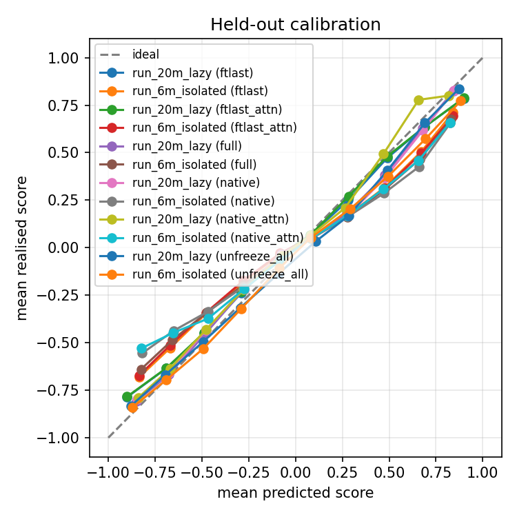

# Downstream probes: sacrifice classification and position score regression (2026-11-15)

## Status

Frozen and fine-tuned downstream evaluation of the two best foundation
checkpoints. Score regression is complete (two recipes, three seeds, held-out
test split; fine-tuning ablations with seed 17). Sacrifice classification is
complete for the frozen encoder and for the last-block/full-encoder ablations.
The sacrifice ablation grid uses a fixed 1M-puzzle subset to bound compute;
the earlier full-corpus frozen runs are retained as a reference.

## Question

How much downstream value do the current foundation checkpoints provide when
used as frozen feature extractors, and which checkpoint is the better starting
point? The answer is deliberately baseline-relative: an aggregate R² without a
simple reference is not interpretable.

## Checkpoints

| | `run_20m_lazy` | `run_6m_isolated` |
|---|---|---|
| file / step | `last.pt`, 120k | `best.pt`, 69k |
| parameters | 21.18M | 6.40M |
| shape | d512, 8 layers, ff1536 | d256, 8 layers, ff1024 |
| `content_pooling` | False (native embed pools the full trunk) | True (native embed pools content only) |
| trained on | 443 shards (2022 standard + elite 2013–2020) | identical |

Both use the current 67-token per-position token stream. The 6m checkpoint's
native `embed()` is **exactly turn-blind**: flipping only the side-to-move
token changes the embedding by L2 0.0, versus 31.9 for the 20m checkpoint.
That is why the full-trunk recipe (recipe A) is run as an alternative.

## Method

### Recipes

- **native** (`encoder.embed()`): the checkpoint's own retrieval embedding.
- **full** (`encoder.encode()`): mean pool over the non-isolated trunk, which
  includes content and the turn/castling/en-passant tokens. This is the same
  output as native for `run_20m_lazy`, and is the only state-aware recipe
  trained end-to-end in both checkpoints.

### Position score regression

- Target: White-perspective final score in `[-1, +1]` (`-1` Black wins, `0`
  draw, `+1` White wins), i.e. the realised game result.
- Data: `patrickfrank1/chess-positions`. Train/validation from the `train`
  split (56k games, 90/10 game-hash split); held-out evaluation on the `test`
  split (20k games: 10k `standard` + 10k `elite` shards, never seen by either
  the checkpoint or the probe).
- Input: one position (`CLS + segment + SEP`), `positions_per_game=16`
  sampled uniformly per epoch; validation and test score every position.
- Head: mean pool → `Linear(d, 256) → GELU → Dropout(0) → Linear(256, 1) →
  tanh`, small final-layer init.
- Loss: MSE. Optimizer: AdamW, LR 1e-3, weight decay 0.01, batch 256, bf16
  autocast with the flash-attn varlen kernel. Encoder frozen.
- Epochs: 3 for the first runs, then 1 once the validation curves showed epoch
  2–3 add nothing (20m: R² 0.0317 → 0.0317, AUC 0.5983 → 0.5985; 6m: flat to
  slightly worse). Runs can additionally stop themselves when the decisive AUC
  is not significantly above 0.5 (`--abort-if-chance`, Hanley–McNeil error).
- Metrics: MSE/MAE/R², decisive-game AUC, Pearson/Spearman, calibration bins.

### Sacrifice classification

Reuses the existing puzzle pipeline (`RollingVariantPlanner`, 50/50 epoch
plans, subsequence variants, pooled sequence head, PR-AUC on the
natural-prevalence validation split). The frozen reference uses the full
6.16M-puzzle corpus. The fine-tuning grid uses the first 1M puzzles (16% of
the corpus; 7.57% sacrifice prevalence versus 7.54% overall, so the class mix
is representative) and otherwise the same hash-based 90/10 split.

Freeze levels are frozen encoder, last transformer block + final norm, and all
encoder parameters. The head is a two-layer `PoolingClassifier` with either
mean or attention pooling over the puzzle's position embeddings. Fine-tuning
uses the full-trunk feature recipe (`encode()`), encoder LR 1e-5, head LR
1e-3, batch 128, one epoch, bf16 autocast, and seed 17. Metrics are PR-AUC
(primary), AUROC, and F1 at the validation-optimal threshold.

## Results — position score regression

Validation split (3 seeds, mean ± std):

| recipe | model | R² | decisive AUC | MAE |
|---|---|---|---|---|
| native | run_20m_lazy | 0.029 ± 0.004 | 0.595 ± 0.004 | 0.859 ± 0.016 |
| full | run_20m_lazy | 0.029 ± 0.004 | 0.594 ± 0.004 | 0.859 ± 0.016 |
| native | run_6m_isolated | 0.004 ± 0.003 | 0.575 ± 0.005 | 0.868 ± 0.016 |
| full | run_6m_isolated | 0.001 ± 0.002 | 0.576 ± 0.003 | 0.867 ± 0.016 |

Held-out test split (3 seeds, mean ± std):

| recipe | model | R² | decisive AUC | MAE |
|---|---|---|---|---|
| native | run_20m_lazy | 0.023 ± 0.001 | 0.587 ± 0.003 | 0.859 ± 0.001 |
| full | run_20m_lazy | 0.024 ± 0.001 | 0.587 ± 0.001 | 0.859 ± 0.001 |
| native | run_6m_isolated | 0.010 ± 0.002 | 0.571 ± 0.001 | 0.867 ± 0.000 |
| full | run_6m_isolated | 0.011 ± 0.001 | 0.573 ± 0.001 | 0.867 ± 0.001 |
| **material baseline** (affine, same data) | — | **0.065** | **0.656** | **0.835** |

The material baseline fits `score = a · material + b` on 80% of the held-out
predictions and scores the remaining 20%. It uses one feature and beats both
checkpoints on every metric.

### Slices (held-out, 20m native; 6m behaves the same or worse)

| slice | n | R² | decisive AUC | MAE |
|---|---:|---:|---:|---:|
| ply 1–10 | 598k | -0.010 | 0.500 | 0.911 |
| ply 11–30 | 1.18M | -0.011 | 0.516 | 0.908 |
| ply 31–60 | 1.50M | +0.009 | 0.573 | 0.884 |
| ply 61+ | 1.47M | +0.083 | 0.677 | 0.773 |
| abs(material) 0 | 2.40M | -0.009 | 0.527 | 0.876 |
| abs(material) 1–3 | 1.88M | +0.023 | 0.599 | 0.854 |
| abs(material) 4–6 | 311k | +0.106 | 0.700 | 0.843 |
| abs(material) 7+ | 153k | +0.330 | 0.863 | 0.699 |

The signal is concentrated exactly where material already decides the game:
balanced positions are indistinguishable from chance (AUC 0.527, R² -0.01),
while large-material endgames reach AUC 0.86. Openings add nothing, as
expected. The 20m model is ahead of the 6m in the late-game and large-material
buckets and identical elsewhere.

## Results — score adaptation ablations

The frozen probes pool per-token states with a **mean** and train only the
head. Two controls test what limits them: how much of the encoder adapts, and
whether a learned pooling operator (over the last per-token layer) matters.

Held-out test split, seed 17 (1 seed for the adapted arms):

| pooling | freeze level | model | R² | decisive AUC | MAE |
|---|---|---|---|---:|---:|---:|
| mean | frozen | run_20m_lazy | 0.024 | 0.587 | 0.859 |
| mean | frozen | run_6m_isolated | 0.010 | 0.571 | 0.867 |
| mean | last block | run_20m_lazy | 0.078 | 0.653 | 0.820 |
| mean | last block | run_6m_isolated | 0.013 | 0.574 | 0.865 |
| mean | **all parameters** | run_20m_lazy | **0.131** | **0.713** | 0.773 |
| mean | **all parameters** | run_6m_isolated | **0.117** | **0.700** | 0.786 |
| attention | frozen | run_20m_lazy | 0.020 | 0.577 | 0.864 |
| attention | frozen | run_6m_isolated | 0.012 | 0.571 | 0.868 |
| attention | last block | run_20m_lazy | 0.079 | 0.653 | 0.820 |
| attention | last block | run_6m_isolated | 0.013 | 0.574 | 0.865 |
| material baseline | — | — | 0.065 | 0.656 | 0.835 |

**Full fine-tuning is the largest single lever.** It roughly triples the
frozen R² and adds 0.13 AUC for both checkpoints, and clears the material
baseline on both metrics. With the whole encoder adapted, the 6m model nearly
catches the 20m (AUC 0.700 vs 0.713, R² 0.117 vs 0.131), so most of the 6m
deficit is recoverable representation capacity rather than a hard capacity
ceiling.

**The pooling operator is not the bottleneck.** Attention pooling matches the
mean within ±0.001 AUC and ±0.004 R² in every cell (frozen and last block,
both checkpoints), and is marginally worse for the frozen 20m (0.577 vs
0.587). The zero-initialised query is free to learn a non-uniform weighting,
but the probe gains nothing from it. What matters is *how much of the encoder
adapts*, not how the last token layer is pooled.

Reading the grid as a whole: frozen 0.57–0.59 AUC → last block 0.65 (20m only)
→ all parameters 0.70–0.71 for both checkpoints. The 20m's last-block gain is
large; the 6m needs the whole encoder before it catches up.

## Results — sacrifice classification

Validation split, natural prevalence, seed 17 (1 seed for every cell). The
fine-tuning grid uses 1M puzzles; the `native` rows are the earlier
full-corpus frozen reference and are not directly comparable to the 1M cells.

| pooling | freeze level | model | PR-AUC | AUROC | F1 |
|---|---|---|---:|---:|---:|
| mean | frozen | run_20m_lazy | 0.203 | 0.697 | 0.262 |
| mean | frozen | run_6m_isolated | 0.200 | 0.685 | 0.254 |
| attention | frozen | run_20m_lazy | 0.203 | 0.697 | 0.261 |
| attention | frozen | run_6m_isolated | 0.201 | 0.686 | 0.254 |
| mean | last block | run_20m_lazy | 0.253 | 0.728 | 0.295 |
| mean | last block | run_6m_isolated | 0.211 | 0.692 | 0.259 |
| attention | last block | run_20m_lazy | 0.254 | 0.728 | 0.294 |
| attention | last block | run_6m_isolated | 0.214 | 0.693 | 0.260 |
| mean | **all parameters** | run_20m_lazy | **0.455** | **0.834** | **0.449** |
| mean | **all parameters** | run_6m_isolated | **0.387** | **0.802** | **0.397** |
| attention | **all parameters** | run_20m_lazy | **0.455** | **0.834** | 0.448 |
| attention | **all parameters** | run_6m_isolated | 0.385 | 0.801 | 0.396 |
| attention | frozen (full corpus) | run_20m_lazy | 0.224 | 0.712 | 0.274 |
| attention | frozen (full corpus) | run_6m_isolated | 0.216 | 0.697 | 0.263 |

Threshold metrics at the validation-optimal F1 threshold (mean pooling; the
attention cells are within ±0.001):

| freeze level | model | precision | recall | accuracy |
|---|---|---:|---:|---:|
| frozen | run_20m_lazy | 0.188 | 0.432 | 0.768 |
| frozen | run_6m_isolated | 0.173 | 0.477 | 0.733 |
| last block | run_20m_lazy | 0.236 | 0.393 | 0.821 |
| last block | run_6m_isolated | 0.191 | 0.401 | 0.782 |
| all parameters | run_20m_lazy | 0.439 | 0.459 | 0.893 |
| all parameters | run_6m_isolated | 0.360 | 0.444 | 0.872 |

**Full fine-tuning is again the dominant lever.** It roughly doubles PR-AUC
for both checkpoints (20m: 0.203 → 0.455; 6m: 0.200 → 0.387) and adds 0.14 /
0.12 AUROC, clearing the full-corpus frozen reference by a wide margin. The
6m checkpoint also improves substantially, but it does not close the gap the
way it did on score regression: the 20m remains ahead by ~0.07 PR-AUC and
~0.03 AUROC.

**Last-block fine-tuning helps the 20m, barely moves the 6m.** The 20m gains
+0.05 PR-AUC and +0.03 AUROC from the last block alone; the 6m gains only
+0.01 PR-AUC and +0.007 AUROC, landing near its full-corpus frozen reference.
Adapting the last block is not enough to unlock the smaller checkpoint.

**The pooling operator is not the bottleneck.** Mean and attention pooling
match within 0.002 PR-AUC, 0.001 AUROC, and 0.001 F1 in every cell, for both
checkpoints and every freeze level. As on score regression, what matters is
how much of the encoder adapts.

**Accuracy is misleading on the natural-prevalence split.** The best model's
accuracy is 0.893, still below the 0.925 accuracy of always predicting
"not sacrifice", while its PR-AUC (0.455) is ~6× the 0.075 prevalence and its
F1 (0.449) is far above the frozen baseline. Read sacrifice with PR-AUC,
AUROC, precision, and recall, not accuracy.

## Findings

1. **Frozen, neither checkpoint is a usable position evaluator.** The best
   held-out decisive AUC is 0.587 (20m), versus 0.656 for an affine function of
   material alone (R² 0.023–0.024 vs 0.065). **Fully fine-tuned they are:**
   AUC 0.713 / R² 0.131 (20m) and 0.700 / 0.117 (6m), both above the material
   baseline. The frozen-probe result measures the representation, not what the
   checkpoint can become.
2. **The 20m checkpoint is consistently the better representation.** It wins by
   ~0.015 AUC and ~0.013 R² on held-out score data, well outside the seed
   standard deviation (0.001–0.003), and by ~0.07 PR-AUC / ~0.03 AUROC after
   full sacrifice fine-tuning.
3. **Neither the turn token nor the pooling operator is the main limit.** The
   full-trunk recipe moves the 6m by +0.002 AUC, and learned attention pooling
   by ±0.001 on score; on sacrifice, mean and attention pooling match within
   0.002 PR-AUC in every cell. Freezing is the constraint: full fine-tuning
   adds +0.126 AUC (20m) and +0.129 (6m) on score.
4. **Full fine-tuning transfers to sacrifice and is the largest lever there
   too.** PR-AUC roughly doubles (20m 0.203 → 0.455, 6m 0.200 → 0.387) and
   both checkpoints clear the full-corpus frozen reference (0.224 / 0.216).
   Last-block adaptation helps the 20m (+0.05 PR-AUC) but barely moves the 6m
   (+0.01), so the smaller checkpoint needs the whole encoder.
5. **The aggregate hides where the signal lives.** The embedding is a weak
   material detector: chance in balanced positions, strong in lopsided
   endgames. Any claim that the representation "understands" a position should
   be read against that slice table.
6. **Accuracy is misleading on natural-prevalence sacrifice.** The best model
   reaches 0.893 accuracy, below the 0.925 always-negative baseline, while its
   PR-AUC is ~6× prevalence. PR-AUC, AUROC, precision, and recall are the
   meaningful sacrifice metrics.
7. **Calibration is compressed toward zero.** Predictions occupy a narrow band
   around the base rate; ranking (AUC) survives while R² does not. The
   calibration plot shows the slope deficit.

## Threats to validity

- The label is the realised game result, not engine ground truth, so even a
  perfect evaluator has a noise ceiling. The material baseline and the slice
  table bound what is achievable.
- The held-out split mixes elite games (draw-heavy) with recent standard-rated
  games, while probe training used the standard-rated `train` split. The test
  numbers therefore include a distribution shift; validation numbers are
  in-distribution and slightly higher.
- Single-position inputs ignore move history. A window ablation with a ridge
  probe on 4k games showed no gain (window 1/4/8 all ~0.56 AUC), but the head
  was not retrained per window.
- The sacrifice fine-tuning grid uses a fixed 1M-puzzle subset (16% of the
  corpus) and one epoch, seed 17. Its class prevalence matches the full corpus
  (7.57% vs 7.54%), but absolute numbers are not directly comparable to the
  full-corpus frozen reference; the relative freeze-level and pooling ordering
  is the result. More epochs would likely raise absolute numbers.
- The adapted arms use a single seed, so the reported gap is not accompanied
  by seed variance. The frozen score grid's seed standard deviation was
  0.001–0.004, well below the observed sacrifice differences.

## Artifacts

- Code: `feature/downstream-probes` (`src/dataset/game_outcomes.py`,
  `src/modeling/score_head.py`, `src/modeling/puzzle_classifier.py`,
  `src/run/train_score_probe.py`, `src/run/train_puzzle_classifier.py`,
  `src/run/eval_score_probe.py`, `scripts/eval/summarize_downstream.py`).
- Runs: `hf://buckets/patrickfrank1/chesspos-checkpoints/downstream/` plus the
  box-local `data/models/downstream/` and `data/eval/downstream/` trees
  (`metrics.json`, `predictions.npz`, checkpoints). Sacrifice checkpoints are
  under `downstream/runs/models/sacrifice/<recipe>/<model>/seed17/`.
- Plan and decisions: [`../plan_downstream_evaluation.md`](../plan_downstream_evaluation.md).

## Next steps

- Run the winning all-parameters sacrifice recipe on the full 6.16M corpus to
  obtain absolute numbers directly comparable to the full-corpus frozen
  reference. The 1M grid already establishes the ordering.
- Try more than one epoch for full fine-tuning; one epoch may underfit the
  adapted encoder, especially on the 6m checkpoint.
- Repeat the adapted sacrifice cells with 3 seeds to attach variance to the
  freeze-level and checkpoint gaps.
- If the goal is a position evaluator, the recipe is "fine-tune, then probe".
  The frozen checkpoint is a feature extractor, not an evaluator.
- Decide whether the next foundation-model work should target material and
  phase structure explicitly (an auxiliary head on the pooled content vector),
  given that those are the only slices with signal in the frozen setting.
- The practical recipe is "fine-tune the model, then probe", not "freeze and
  probe"; this now holds for both score regression and sacrifice.
