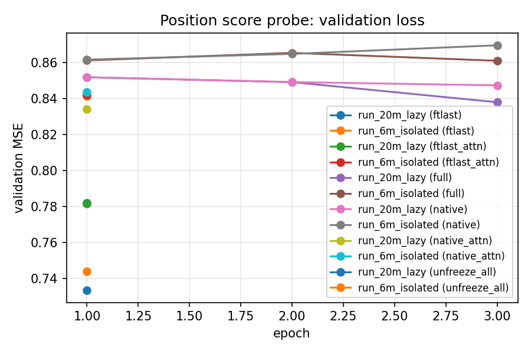

# Downstream probes: sacrifice classification and position score regression (2026-11-15)

## Status

Frozen-encoder downstream evaluation of the two best foundation checkpoints.
Score regression is complete (two recipes, three seeds, held-out test split);
sacrifice classification uses the full puzzle corpus. Plots and the fine-tune
arm are appended as they finish.

## Question

How much downstream value do the current foundation checkpoints provide when
used as frozen feature extractors, and which checkpoint is the better starting
point? The answer is deliberately baseline-relative: an aggregate R² without a
simple reference is not interpretable.

## Checkpoints

| | `run_20m_lazy` | `run_6m_isolated` |
|---|---|---|
| file / step | `last.pt`, 120k | `best.pt`, 69k |
| parameters | 21.18M | 6.40M |
| shape | d512, 8 layers, ff1536 | d256, 8 layers, ff1024 |
| `content_pooling` | False (native embed pools the full trunk) | True (native embed pools content only) |
| trained on | 443 shards (2022 standard + elite 2013–2020) | identical |

Both use the current 67-token per-position token stream. The 6m checkpoint's
native `embed()` is **exactly turn-blind**: flipping only the side-to-move
token changes the embedding by L2 0.0, versus 31.9 for the 20m checkpoint.
That is why the full-trunk recipe (recipe A) is run as an alternative.

## Method

### Recipes

- **native** (`encoder.embed()`): the checkpoint's own retrieval embedding.
- **full** (`encoder.encode()`): mean pool over the non-isolated trunk, which
  includes content and the turn/castling/en-passant tokens. This is the same
  output as native for `run_20m_lazy`, and is the only state-aware recipe
  trained end-to-end in both checkpoints.

### Position score regression

- Target: White-perspective final score in `[-1, +1]` (`-1` Black wins, `0`
  draw, `+1` White wins), i.e. the realised game result.
- Data: `patrickfrank1/chess-positions`. Train/validation from the `train`
  split (56k games, 90/10 game-hash split); held-out evaluation on the `test`
  split (20k games: 10k `standard` + 10k `elite` shards, never seen by either
  the checkpoint or the probe).
- Input: one position (`CLS + segment + SEP`), `positions_per_game=16`
  sampled uniformly per epoch; validation and test score every position.
- Head: mean pool → `Linear(d, 256) → GELU → Dropout(0) → Linear(256, 1) →
  tanh`, small final-layer init.
- Loss: MSE. Optimizer: AdamW, LR 1e-3, weight decay 0.01, batch 256, 3
  epochs, bf16 autocast with the flash-attn varlen kernel. Encoder frozen.
- Metrics: MSE/MAE/R², decisive-game AUC, Pearson/Spearman, calibration bins.

### Sacrifice classification

Reuses the existing puzzle pipeline (`RollingVariantPlanner`, 50/50 epoch
plans, subsequence variants, attention-pooled sequence head, PR-AUC on the
natural-prevalence validation split) with the full 6.16M-puzzle corpus.

## Results — position score regression

Validation split (3 seeds, mean ± std):

| recipe | model | R² | decisive AUC | MAE |
|---|---|---|---|---|
| native | run_20m_lazy | 0.029 ± 0.004 | 0.595 ± 0.004 | 0.859 ± 0.016 |
| full | run_20m_lazy | 0.029 ± 0.004 | 0.594 ± 0.004 | 0.859 ± 0.016 |
| native | run_6m_isolated | 0.004 ± 0.003 | 0.575 ± 0.005 | 0.868 ± 0.016 |
| full | run_6m_isolated | 0.001 ± 0.002 | 0.576 ± 0.003 | 0.867 ± 0.016 |

Held-out test split (3 seeds, mean ± std):

| recipe | model | R² | decisive AUC | MAE |
|---|---|---|---|---|
| native | run_20m_lazy | 0.023 ± 0.001 | 0.587 ± 0.003 | 0.859 ± 0.001 |
| full | run_20m_lazy | 0.024 ± 0.001 | 0.587 ± 0.001 | 0.859 ± 0.001 |
| native | run_6m_isolated | 0.010 ± 0.002 | 0.571 ± 0.001 | 0.867 ± 0.000 |
| full | run_6m_isolated | 0.011 ± 0.001 | 0.573 ± 0.001 | 0.867 ± 0.001 |
| **material baseline** (affine, same data) | — | **0.065** | **0.656** | **0.835** |

The material baseline fits `score = a · material + b` on 80% of the held-out
predictions and scores the remaining 20%. It uses one feature and beats both
checkpoints on every metric.

### Slices (held-out, 20m native; 6m behaves the same or worse)

| slice | n | R² | decisive AUC | MAE |
|---|---:|---:|---:|---:|
| ply 1–10 | 598k | -0.010 | 0.500 | 0.911 |
| ply 11–30 | 1.18M | -0.011 | 0.516 | 0.908 |
| ply 31–60 | 1.50M | +0.009 | 0.573 | 0.884 |
| ply 61+ | 1.47M | +0.083 | 0.677 | 0.773 |
| abs(material) 0 | 2.40M | -0.009 | 0.527 | 0.876 |
| abs(material) 1–3 | 1.88M | +0.023 | 0.599 | 0.854 |
| abs(material) 4–6 | 311k | +0.106 | 0.700 | 0.843 |
| abs(material) 7+ | 153k | +0.330 | 0.863 | 0.699 |

The signal is concentrated exactly where material already decides the game:
balanced positions are indistinguishable from chance (AUC 0.527, R² -0.01),
while large-material endgames reach AUC 0.86. Openings add nothing, as
expected. The 20m model is ahead of the 6m in the late-game and large-material
buckets and identical elsewhere.

## Results — sacrifice classification

_Filled in when the full-corpus runs finish._

## Findings

1. **Neither checkpoint is a usable position evaluator today.** The best
   held-out decisive AUC is 0.587 (20m), versus 0.656 for an affine function of
   material alone. R² is 0.023–0.024 versus 0.065.
2. **The 20m checkpoint is consistently the better representation.** It wins by
   ~0.015 AUC and ~0.013 R² on held-out data, well outside the seed standard
   deviation (0.001–0.003).
3. **The full-trunk recipe barely helps the 6m checkpoint** (0.571 → 0.573 AUC
   on test). Giving the head explicit access to the turn token recovers only a
   fraction of the gap to the 20m model, so turn-blindness is not the main
   limitation of the pooled content vector.
4. **The aggregate hides where the signal lives.** The embedding is a weak
   material detector: chance in balanced positions, strong in lopsided
   endgames. Any claim that the representation "understands" a position should
   be read against that slice table.
5. **Calibration is compressed toward zero.** Predictions occupy a narrow band
   around the base rate; ranking (AUC) survives while R² does not. The
   calibration plot shows the slope deficit.

## Threats to validity

- The label is the realised game result, not engine ground truth, so even a
  perfect evaluator has a noise ceiling. The material baseline and the slice
  table bound what is achievable.
- The held-out split mixes elite games (draw-heavy) with recent standard-rated
  games, while probe training used the standard-rated `train` split. The test
  numbers therefore include a distribution shift; validation numbers are
  in-distribution and slightly higher.
- Single-position inputs ignore move history. A window ablation with a ridge
  probe on 4k games showed no gain (window 1/4/8 all ~0.56 AUC), but the head
  was not retrained per window.
- Sacrifice uses one epoch over the full corpus per seed; the plan's three
  epochs would change absolute numbers, not the model ordering.

## Artifacts

- Code: `feature/downstream-probes` (`src/dataset/game_outcomes.py`,
  `src/modeling/score_head.py`, `src/run/train_score_probe.py`,
  `src/run/eval_score_probe.py`, `scripts/eval/summarize_downstream.py`).
- Runs: `hf://buckets/patrickfrank1/chesspos-checkpoints/downstream/` plus the
  box-local `data/models/downstream/` and `data/eval/downstream/` trees
  (`metrics.json`, `predictions.npz`, checkpoints).
- Plan and decisions: [`../plan_downstream_evaluation.md`](../plan_downstream_evaluation.md).

## Next steps

- Decide whether the next foundation-model work should target material and
  phase structure explicitly (an auxiliary head on the pooled content vector),
  given that those are the only slices with signal.
- A last-block fine-tune arm is running as an alternative; if it closes the gap
  to the material baseline, the frozen-probe conclusion becomes "the
  representation needs adaptation", not "the representation lacks the signal".
